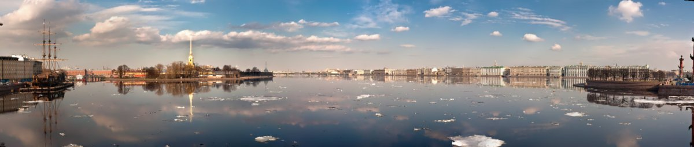
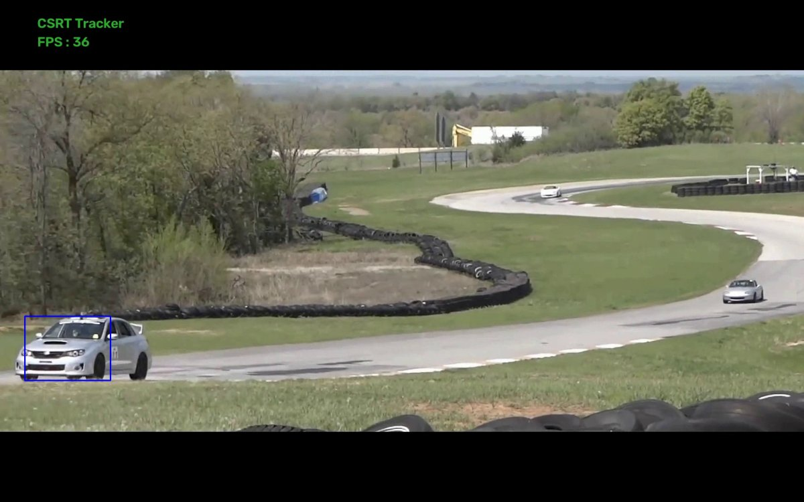

# Computer Vision Lab

My working notebooks and scripts from the free
[OpenCV Bootcamp](https://opencv.org/university/free-opencv-course/) course by
OpenCV University (OpenCV.org). It covers 12 of the course's 14 modules: image
basics through panorama stitching, HDR, object tracking and DNN face detection,
all in Python with OpenCV.

**What's mine and what isn't.** The notebooks, scripts and asset files are
OpenCV Bootcamp course material. My work on top of it:

- Made the video-writing (06) and object-tracking (11) notebooks run locally on
  Windows. The course versions assume Google Colab (`apt-get`, `/content/` paths).
  I replaced those with portable paths, `imageio-ffmpeg` for H.264 conversion and
  explicit error handling.
- Fixed the HDR notebook (10). Mantiuk tone mapping produced NaN pixels that
  corrupted the saved image.
- Switched the tracking notebook to `opencv-contrib-python` so the legacy trackers
  (Boosting, TLD, MedianFlow, MOSSE) are available.
- Added line-by-line study notes to the camera scripts (05, 07) explaining array
  shapes, BGR order, `waitKey` and the filter parameters.
- Made the image-display demo (01) work from any working directory.

## Screenshots

| Panorama stitching (09) | CSRT object tracking (11) |
| --- | --- |
|  |  |

Both were generated locally from the course's sample images and video.

<!-- TODO: add docs/images/camera-filters-canny.jpg (camera_filters.py in Canny mode, key C) -->

## Modules

✏️ = has my own changes (see above). Everything else is course material run as-is.

| # | Module | What it covers | Files |
| --- | --- | --- | --- |
| 01 | Image basics | Reading, displaying and saving images; grayscale vs. color; BGR vs. RGB channels | Notebook, `display_image.py` ✏️ |
| 02 | Image manipulation | Pixel access, cropping, resizing, flipping | Notebook |
| 03 | Image annotation | Drawing lines, circles, rectangles and text | Notebook |
| 04 | Image enhancement | Brightness/contrast arithmetic, thresholding, bitwise ops, logo masking | Notebook |
| 05 | Camera access | Live webcam/video preview with `VideoCapture` | `camera.py` ✏️ |
| 06 | Video writing | Writing AVI/MP4 with `VideoWriter`, converting to H.264 for playback | Notebook ✏️ |
| 07 | Image filtering | Live blur, Canny edges and Shi-Tomasi corners on a camera feed | `camera_filters.py` ✏️ |
| 08 | Features and alignment | ORB keypoints + homography to align a scanned form to a template | Notebook |
| 09 | Panorama | Stitching overlapping photos with `cv2.Stitcher` | Notebook |
| 10 | HDR imaging | Debevec camera-response calibration, exposure merging, tone mapping | Notebook ✏️ |
| 11 | Object tracking | Comparing OpenCV trackers (KCF, CSRT, GOTURN, ...) on a video | Notebook ✏️ |
| 12 | Face detection | Real-time face detection with a ResNet-10 SSD Caffe model (`cv2.dnn`) | `face_detection.py` |

Not included: the course's last two modules (TensorFlow object detection, OpenPose).

## Setup

Requires Python 3.10+ with a desktop (GUI) session, since the scripts open OpenCV
windows. Tested on Windows 11 with Python 3.14 and OpenCV 5.0. In PowerShell, from
the repository root:

```powershell
python -m venv .venv
.\.venv\Scripts\Activate.ps1
python -m pip install -r requirements.txt
python main.py   # prints the OpenCV version, confirms cv2 imports
```

`requirements.txt` installs `opencv-contrib-python`, not `opencv-python`. Don't
install both: they conflict.

## Running the scripts

The camera scripts use webcam 0 by default. Pass a video file or stream URL
instead to run without a camera.

**Camera preview (05).** Press `Esc` to quit.

```powershell
python notebooks/05-camera-access/camera.py
```

**Live filters (07).** Keys: `P` preview, `B` blur, `C` Canny edges,
`F` corner features, `Q`/`Esc` quit. Click the window first so it gets the keys.

```powershell
python notebooks/07-image-filtering-and-edge-detection/camera_filters.py
# or, without a webcam:
python notebooks/07-image-filtering-and-edge-detection/camera_filters.py notebooks/06-video-writing/race_car.mp4
```

**Face detection (12).** Run from the module folder. The first run downloads the
course's Caffe model files there. Press `Esc` to quit.

```powershell
Set-Location notebooks/12-face-detection
python face_detection.py
```

**Image display demo (01).** Close the Matplotlib plot to continue. The first two
OpenCV windows close after 8 seconds each. Press any key in the third and `q` in
the last.

```powershell
python notebooks/01-image-basics/display_image.py
```

## Running the notebooks

Start Jupyter from inside a module folder, so the notebook finds its assets by
relative path:

```powershell
Set-Location notebooks/09-panorama-creation
jupyter notebook 09_panorama.ipynb
```

Each notebook downloads its course asset zip if it's missing. The tracking
notebook (11) needs a kernel restart after its setup cell installs
`opencv-contrib-python`.

## Testing

There is no automated test suite; this is a learning repo. To check an install,
run `python main.py` (OpenCV imports and prints its version), then run
`camera_filters.py` on `race_car.mp4` as shown above and cycle through the filter
keys.

## Credits

- Course: [OpenCV Bootcamp](https://opencv.org/university/free-opencv-course/),
  OpenCV University / OpenCV.org. Notebooks, scripts, images, videos and models
  in `notebooks/` come from the course, and their copyright stays with OpenCV.org
  and the original authors.
- GOTURN tracker model: Held, Thrun and Savarese, *Learning to Track at 100 FPS
  with Deep Regression Networks* (ECCV 2016).
